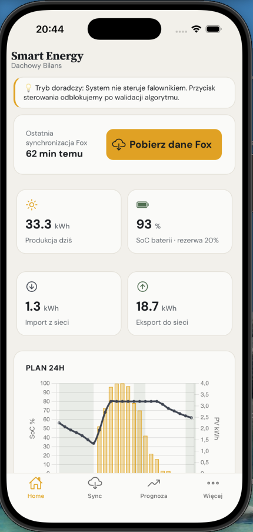
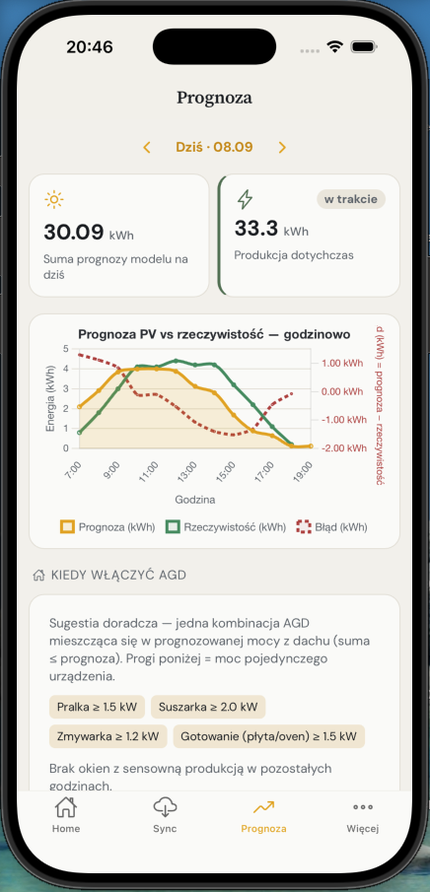
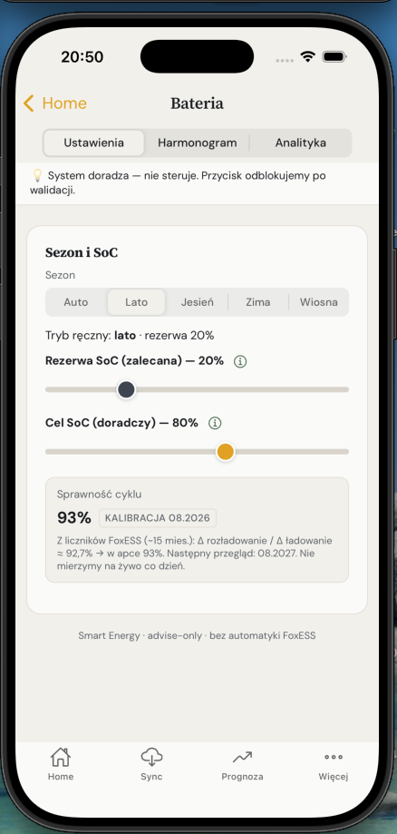
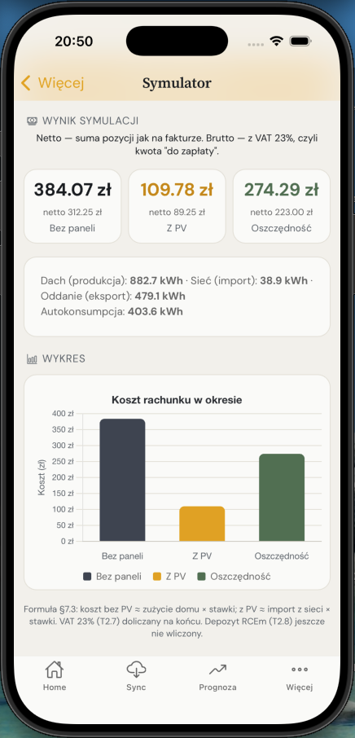
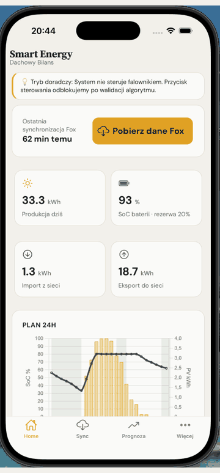

# Smart Energy Model

**Autor:** Marta Gałuszka  
**Typ:** praca dyplomowa — domowa fotowoltaika z magazynem energii

Aplikacja prognozuje produkcję z paneli, podpowiada kiedy uruchomić sprzęt w domu i jak prowadzić magazyn. Liczby w aplikacji są zestawiane z odczytem prawdziwej instalacji.

Publicznie zostawiam tę wizytówkę. Kod źródłowy z pracy udostępniam na prośbę, na czas rozmowy, w wersji bez danych domowych. Napisz do mnie na GitHubie: [MartaGaluszka](https://github.com/MartaGaluszka).

## Podgląd

## Stos

- Python i model godzinowy produkcji
- API w FastAPI
- aplikacja mobilna Ionic / Capacitor
- porównanie prognozy z odczytem instalacji
